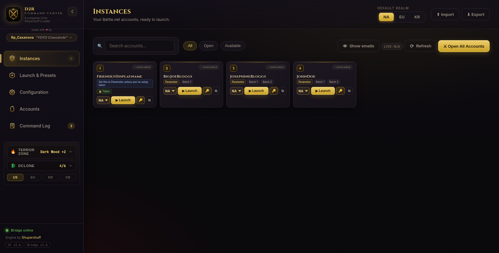
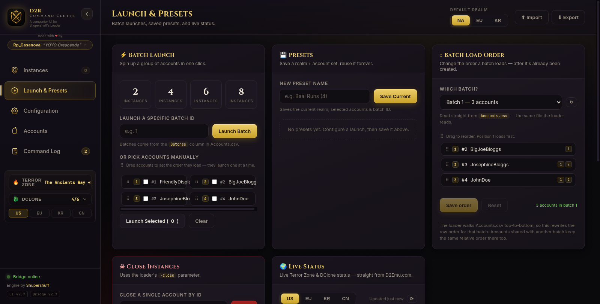
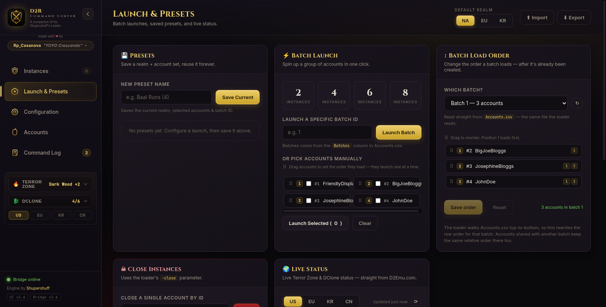
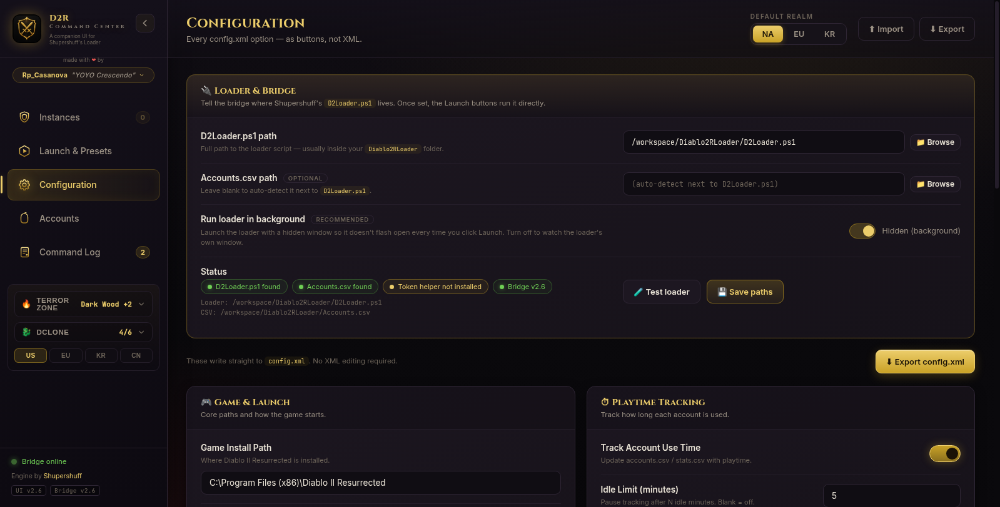
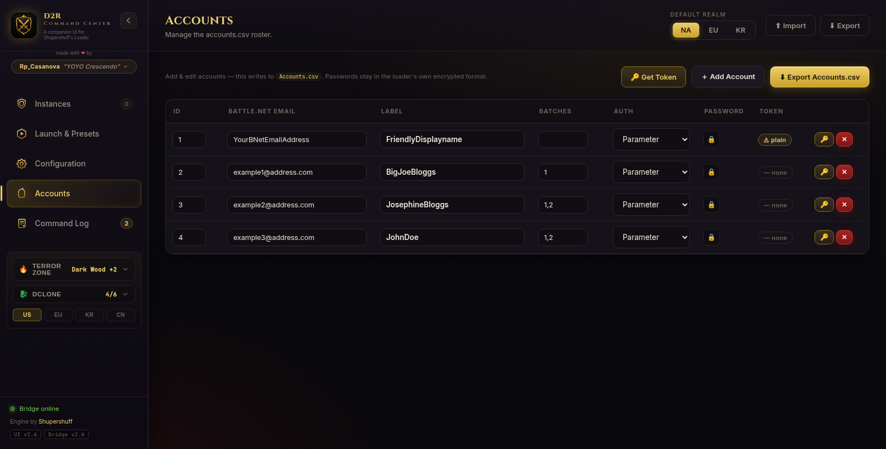

# ⚔ D2R Command Center

**A button-driven companion UI for [Shupershuff's Diablo2RLoader](https://github.com/shupershuff/Diablo2RLoader).**

> ### 🛡 Shupershuff's loader is left 100% intact.
> This project is a **front-end only**. It does not fork, patch, rewrite, wrap,
> decompile, or "improve" his PowerShell. `D2Loader.ps1` is treated as a
> **read-only engine**: the Command Center calls it with the exact parameters it
> already documents (`-all`, `-batch`, `-close`, `-manual`, `-region`, `-pw`), and
> reads/writes the same `config.xml` and `Accounts.csv` files he already uses.
> **Not one line of his code is modified.** If you delete this project tomorrow,
> his loader still works exactly as it always did — because nothing of his was
> ever touched.

<p align="center">
  
</p>

---

## Table of contents

- [Why this exists](#why-this-exists)
- [The non-invasive promise](#the-non-invasive-promise)
- [Features](#features)
- [Screenshots](#screenshots)
- [Requirements](#requirements)
- [Install (60 seconds)](#install-60-seconds)
- [Using it](#using-it)
- [Batch load order](#batch-load-order)
- [The Get Token feature](#the-get-token-feature)
- [How it talks to the loader](#how-it-talks-to-the-loader)
- [Updating](#updating)
- [Troubleshooting](#troubleshooting)
- [Project layout](#project-layout)
- [Credits](#credits)
- [License](#license)

---

## Why this exists

Shupershuff's loader is excellent at the hard part: multi-boxing Diablo II
Resurrected, handling Battle.net tokens, launching N copies of the game with the
right realm, window position and arguments. What it is *not* is pretty. Out of
the box it is a **PowerShell text menu** — you type a number, press Enter, and
read a wall of console output.

D2R Command Center gives that engine a face:

- a **Diablo-themed dark UI** with gold accents, real buttons and toggles,
- **one card per account**, each with its own realm picker and Launch button,
- **batch launching** (2 / 4 / 6 / 8 instances, or a specific batch ID),
- **drag-and-drop ordering** for both manual launches and saved batches,
- **every `config.xml` option** as a control, so you never open Notepad again,
- **automatic Battle.net token capture**, so tokens stop expiring mid-session,
- **live Terror Zone and DClone status** pulled straight from D2Emu,
- and a **Command Log** that shows you the exact command that was sent, so
  nothing is a black box.

The whole thing runs locally. There is no account, no cloud, no telemetry, no
server of ours. Your passwords and tokens never leave your PC.

---

## The non-invasive promise

This is the part that matters most, so it gets its own section.

**What we do:**

| We do this | Because |
|---|---|
| Call `D2Loader.ps1` with its own documented parameters | It is the public interface Shupershuff already built |
| Read `config.xml` and write it back with the same schema | It is the file his loader already reads |
| Read and write `Accounts.csv` with the same columns and order | It is the file his loader already reads |
| Use his own DPAPI secret format (`ConvertFrom-SecureString`) | So his engine can decrypt what we store |
| Show you the exact command line before/after launch | Transparency, not magic |
| Keep a `.bak` of `Accounts.csv` before reordering rows | So a mistake is one file-copy away from undone |

**What we never do:**

- ❌ Never edit, patch, rename or replace `D2Loader.ps1`
- ❌ Never ship our own copy of his loader
- ❌ Never change his `config.xml` schema or add custom keys
- ❌ Never add columns to `Accounts.csv` that his parser would choke on
- ❌ Never run a second loader in parallel (one token per IP at a time — his
  rule, and we respect it)
- ❌ Never require an internet service of ours to function

If you are a Diablo2RLoader user who is nervous about third-party tools: this is
the one you can audit. Open `app/server.js` — every loader call is a single
`spawn` of `powershell` with an argument array, in plain sight. Open
`scripts/launch-loader.ps1` — it is a thin argument builder, not a reimplementation.

---

## Features

| Area | What it does |
|---|---|
| **Instances** | Every account as a card — label, email, batch tags, auth method, playtime. One-click **Launch** / **Close**. Search and filter (All / Open / Available). Live detection of instances you closed outside the app. |
| **Batch Launch** | Quick-launch **2 / 4 / 6 / 8** instances, launch a specific **batch ID**, or hand-pick accounts. |
| **Batch Load Order** | Pick a batch that already exists and **drag its accounts into the order you want them to load** — saved straight back to `Accounts.csv`. |
| **Open All** | One button for the loader's `-all` parameter. |
| **Presets** | Save a **default realm + account set + batch ID** and reuse it forever. |
| **Configuration** | *Every* `config.xml` option as a toggle, dropdown or number box — no XML editing. |
| **Loader & Bridge** | Point the bridge at your `D2Loader.ps1` from inside the UI, with a native **Browse…** dialog and live status. |
| **Accounts** | Add / edit / remove accounts in a table. Writes `Accounts.csv` in his format. Collapsible password column, large readable labels. |
| **🔑 Get Token** | Signs in to Battle.net for you and captures the auth token automatically. |
| **Command Log** | Shows the exact command sent to `D2Loader.ps1`, with a copy button. |
| **Import / Export** | Pull in your real `config.xml` + `Accounts.csv`, export updated ones. |
| **Live Status** | Terror Zone and DClone panels, plus always-visible sidebar drop-downs with US / EU / KR / CN region buttons. |
| **Window memory** | Move or resize the window once — it reopens exactly there, every time. |
| **Single instance** | Clicking the desktop icon 10 times still gives you one Command Center, one bridge, one UI window. |

---

## Screenshots

| Launch & Presets | Batch Load Order |
|---|---|
|  |  |

| Configuration | Accounts |
|---|---|
|  |  |

---

## Requirements

- **Windows 10 or 11** (the loader itself is Windows-only; this UI is too)
- **[Shupershuff's Diablo2RLoader](https://github.com/shupershuff/Diablo2RLoader)** already installed and working
- **Node.js 18+** — the installer will download and unpack a portable copy for
  you if you don't have one, so this is optional in practice
- **PowerShell 5.1** (built into Windows)
- About **80 MB** of disk, and roughly **120–250 MB** of RAM while the UI is open

You do **not** need Python, .NET SDK, Visual Studio, or an internet connection
after setup (except for Battle.net logins and the optional live-status panels).

---

## Install (60 seconds)

1. **Unzip** the release into a folder you'll keep, e.g. `C:\D2R-Command-Center`.
   Keep all files together — the `.bat` files expect their `scripts\` and `app\`
   folders beside them.
2. **Double-click `Install-D2R-Command-Center.bat`.**
3. If Windows asks *"Do you want to allow this app to make changes?"* click
   **Yes** — that's the same elevation the loader itself needs to start the game.
4. Wait for the green **Setup complete** line. It will have:
   - installed its helper dependency (`playwright-core`) into `app\node_modules`,
   - auto-detected your `D2Loader.ps1` (you can change it later in Configuration),
   - created a **D2R Command Center** shortcut on your Desktop,
   - started the app and opened the UI.
5. From then on, just double-click the **D2R Command Center** desktop icon.

The installer is idempotent: run it again any time and it repairs what's missing
without wiping your accounts or settings.

> **First-run note:** the very first time you launch, Windows Firewall may ask
> about Node.js. The bridge only listens on `127.0.0.1:8787` (loopback), so you
> can safely click **Cancel** — nothing outside your PC can reach it.

---

## Using it

**Instances** is home. Each account card shows its label, email, batch tags and
auth method. Pick a realm (NA / EU / KR) and hit **▶ Launch**. The card turns
green while that instance is running, and it notices if you close the game
yourself — no refresh needed, though there is a **⟳ Refresh** button if you want
one.

**Launch & Presets** is where batches live. The quick buttons fire 2, 4, 6 or 8
instances; the batch-ID box launches a named batch from `Accounts.csv`; and
*Or pick accounts manually* lets you drag cards into an exact load order before
hitting **Launch Selected**. The loader runs them **one at a time**, waiting for
token authentication to finish before the next one starts — that ordering is
enforced by his engine, not by us.

**Configuration** mirrors `config.xml`. Change a toggle, and the file is written
in his schema immediately. Nothing is invented: if a setting isn't in his
`config.xml`, it isn't in our UI.

**Accounts** edits `Accounts.csv`. The **🔑** button opens Get Token. Passwords
are stored as a collapsed lock button — click to reveal — and the Label column is
deliberately large because that's the column you actually read.

**Command Log** is the honesty panel: every launch, every token write, every
config change, with the literal command line used.

---

## Batch load order

This is the feature people ask for most, and it deserves an explanation because
it's the one place where we write to a file the loader owns.

**The problem:** Shupershuff's loader collects a batch by walking `Accounts.csv`
**top to bottom** and appending every row whose `Batches` column contains the
requested batch ID. That means **CSV row order *is* the load order.** Once a
batch is created, the only way to change its sequence is to change the row order.

**What the UI does:** open **Launch & Presets → ↕ Batch Load Order**, pick a
batch, and drag the rows. When you hit **Save order**, the bridge rewrites *only
the rows belonging to that batch* into their new sequence, leaving every other
row at its exact original position. Then it writes the file back in the same
column layout, same quoting rules, same header.

**Safeguards:**

- The request must contain **exactly** the accounts currently in that batch —
  same set, no additions, no omissions. Otherwise the bridge refuses and tells
  you what it expected.
- A one-time `Accounts.csv.bak` is written before the first reorder, so you can
  always roll back with a copy/paste.
- Accounts that belong to **two** batches keep their relative order in the other
  batch too — we don't reshuffle rows that aren't in the batch you're editing.
- The loader is never running while we write; the file is written atomically and
  flushed before the response returns.

Full details, including the exact algorithm and the loader source line it relies
on, are in [`docs/BATCH-LOAD-ORDER.md`](docs/BATCH-LOAD-ORDER.md).

---

## The Get Token feature

Battle.net tokens expire. The old workflow was: open a browser, log in, watch the
page fail to load `http://localhost:0/...`, then dig the `?ST=` value out of the
address bar and paste it into `Accounts.csv`.

**🔑 Get Token** does that for you:

1. Start the bridge so the sidebar reads **“Bridge online · token ready”**.
2. Go to **Accounts** and click **🔑 Get Token** (toolbar, or the 🔑 on any row).
3. Pick the account, confirm the Battle.net email, type the password (or reuse
   the one already stored), choose realm and mode.
4. Click **Get Token** and watch the live log. The token lands in `Accounts.csv`
   automatically, encrypted in **his** DPAPI format.

Under the hood it drives a real Edge/Chrome via Playwright, intercepts the
redirect to `http://localhost:0/?ST=…` (a deliberately unreachable port, which is
why the URL has to be captured rather than loaded), and extracts the `US-…-…`
token. If Battle.net throws a CAPTCHA or a 2FA prompt, the headless attempt
detects it and re-opens a **visible** window so you can finish by hand.

Secrets are handed to PowerShell over **STDIN**, never as a command-line
argument, so they never appear in the process list.

---

## How it talks to the loader

```
┌────────────────────┐   HTTP (127.0.0.1:8787)   ┌──────────────────┐
│  UI (Chromium)     │ ────────────────────────► │  Node bridge     │
│  index.html/app.js │ ◄──────────────────────── │  app/server.js   │
└────────────────────┘                           └────────┬─────────┘
                                                          │ spawn powershell
                                                          ▼
                                          ┌───────────────────────────────┐
                                          │ scripts/launch-loader.ps1     │
                                          │  (argument builder only)      │
                                          └───────────────┬───────────────┘
                                                          │ calls, unmodified
                                                          ▼
                                          ┌───────────────────────────────┐
                                          │ D2Loader.ps1  (Shupershuff's) │
                                          │  READ-ONLY — never edited     │
                                          └───────────────────────────────┘
```

The bridge binds to **loopback only**. It has no authentication because it has no
network surface — if you can reach `127.0.0.1:8787` you are already on the
machine and can run the loader yourself anyway. There is no remote endpoint, no
analytics call, no update phone-home.

A full endpoint list and the reasoning behind each design decision lives in
[`docs/ARCHITECTURE.md`](docs/ARCHITECTURE.md).

---

## Updating

Releases ship as a **flat zip**, so you have two options:

**A — one-click updater (recommended).** Unzip the new release into an empty
folder, run `Update-D2R-Command-Center.bat`, and it will find your install, stop
it, replace program files, **keep** your `bridge.config.json` and `data\`,
**refresh the desktop shortcut**, and restart. It never touches `D2Loader.ps1`.

**B — flat overwrite.** Extract the zip straight over your existing folder and
replace files. Your `bridge.config.json` and `data\` are not in the zip, so they
survive.

After updating, check the sidebar footer: it should read **`UI v2.6`** and
**`Bridge v2.6`**. If the numbers disagree, the update didn't finish — run the
updater again.

---

## Troubleshooting

**The desktop icon needs several clicks before anything happens.**
Fixed in v2.5. The old helper tested the bridge via `localhost`, which on some
PCs resolves to IPv6 `::1` first and times out even though the bridge is fine.
It now uses `127.0.0.1`, waits up to 40 seconds with one automatic retry, and
uses a named mutex so rapid double-clicks queue instead of racing. If it still
can't start, you now get a message box pointing at `bridge.log` instead of
silence.

**After updating, the desktop shortcut errors or opens the old version.**
Fixed in v2.5. The shortcut maker now validates the existing `.lnk` (target,
arguments, working directory, icon, and whether the target file still exists)
and repairs it in place; the updater also refreshes the shortcut as a mandatory
step and pokes Explorer with `ie4uinit.exe -show` so the icon redraws.

**“Bridge offline”.** Run `Start-D2R-Command-Center.bat`. If it persists, open
`bridge.log` in the install folder — every start attempt is timestamped there.

**Loader path not set.** Configuration → Loader & Bridge → **Browse…** and pick
`D2Loader.ps1`.

**Token shows a `⚠ plain` badge.** The bridge couldn't reach PowerShell to
encrypt it, so it stored plain text. His loader won't accept that. Run
`Install-D2R-Command-Center.bat` to repair the helper, then re-run Get Token.

**Two loaders launch at once.** You're on an old version, or you launched from
outside the app. The Command Center serialises launches through a queue so token
auth finishes before the next account starts. One token per IP at a time.

**High memory use.** The UI is a Chromium window; 120–250 MB is normal. You can
run with `-nobrowser` (the app then serves the UI but doesn't open a window) and
open it in any browser you already have running.

---

## Project layout

```
D2R-Command-Center\
├─ Install-D2R-Command-Center.bat      one-click setup
├─ Update-D2R-Command-Center.bat       one-click updater
├─ Create-Desktop-Shortcut.bat         re-create / repair the shortcut
├─ Start-D2R-Command-Center.bat        start bridge + UI
├─ Stop-D2R-Command-Center.bat         stop everything
├─ README.txt                          end-user readme
├─ VERSION.txt                         installed version + changelog
├─ app\                                the program
│  ├─ server.js                        local bridge (Express-less, pure http)
│  ├─ index.html / app.js / styles.css the UI
│  ├─ token-helper.js                  Playwright token capture
│  └─ package.json
├─ scripts\                            PowerShell + VBS helpers
│  ├─ bridge-ctl.ps1                   ensure/start/stop, mutex, logging
│  ├─ launch-command-center.vbs        silent launcher + error dialog
│  ├─ make-shortcut.ps1                self-healing .lnk builder
│  ├─ launch-loader.ps1                argument builder for D2Loader.ps1
│  ├─ update.ps1                       updater
│  ├─ auto-detect-loader.ps1           finds D2Loader.ps1
│  ├─ ensure-node.ps1                  portable Node bootstrap
│  └─ secrets.ps1                      DPAPI encrypt/decrypt helper
├─ assets\                             d2r.ico, d2r.png
├─ data\                               sample Accounts.csv / config.xml, levels.txt
└─ docs\                               technical README.md
```

This `github\` folder is **documentation only** and is intentionally excluded
from the distribution zip — delete it freely if you want a lean install.

---

## Credits

- **Engine, loader, and all the hard reverse-engineering:**
  [**Shupershuff**](https://github.com/shupershuff/Diablo2RLoader). This project
  is a love letter to his work and would not exist without it. If you enjoy
  multi-boxing D2R, go star his repo.
- **UI, bridge, and glue:** **Rp_Casanova "YOYO Crescendo"**
  — [Twitch](https://www.twitch.tv/rp_casanova) ·
  [YouTube](https://www.youtube.com/@YOYOCrescendo) ·
  [Tip](https://streamlabs.com/rp_casanova1/tip)
- **Live Terror Zone / DClone data:** [D2Emu](https://www.d2emu.com)
- **Diablo II Resurrected** is a trademark of Blizzard Entertainment. This is an
  unofficial fan tool, not affiliated with or endorsed by Blizzard.

---

## License

MIT — see [LICENSE](LICENSE). That covers **this** project's code only.
`D2Loader.ps1` remains Shupershuff's work under his own terms; we don't
redistribute it, and you should get it from
[his repository](https://github.com/shupershuff/Diablo2RLoader).
